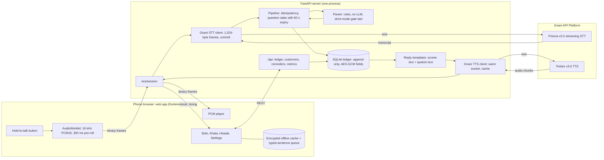

# KhataVaani

KhataVaani is a voice ledger for kirana udhaar. The shopkeeper holds one button, says a sentence in Hindi or Hinglish,
and hears a short spoken confirmation while the entry is written to an encrypted, append-only ledger.

> "Ramesh ka 340 udhaar, kal 200 diya tha"

The sentence becomes two entries: Ramesh owes 340 (credit), and Ramesh paid 200 yesterday (payment). The reply is
"2 entry likhi: Ramesh ke ₹340 udhaar, kal ke ₹200 jama." Amounts and direction come from a rule-based parser, not
from a language model, so the same sentence always gives the same entry.

## A 60-second tour

1. Tap "Shuru karein". KhataVaani says: "Namaste! Main KhataVaani hoon, ek AI sahayak."
2. Hold the button and say "Ramesh ka 340 udhaar". Ramesh is a new name, so it asks "Ramesh naya grahak hai. Khata
   banaun?" Say "haan". A card appears: + 340 Credit.
3. Hold and say "Nahi, 430". The 340 card is struck through and a + 430 card appears.
4. Hold and say "Aur 200 payment mila", then "Ramesh ka total?". The reply: "Ramesh ke ₹230 baaki hain."
5. Press the button while a reply is playing. The reply stops at once.

The full script, with exact replies and the balance after every step, is in [docs/DEMO_SCRIPT.md](docs/DEMO_SCRIPT.md).

## What is built

Each item has code behind it. Automated tests are listed in [docs/TESTING.md](docs/TESTING.md); the per-case status of
the edge-case list is in [docs/EDGE_REPORT.md](docs/EDGE_REPORT.md).

- Exact amounts in any spoken form: digits, Indian digit grouping, Devanagari digits, Hindi words up to 9,99,999,
  fractions (sawa, saade, paune, dedh, dhai), English words ("three forty"), `2k`, `1.5 lakh`, crore. Tested over every
  amount from 1 to 9,99,999.
- Credit and payment direction from the shopkeeper's point of view, compound sentences, and relative dates
  (aaj, kal, parso, N din pehle).
- Spoken corrections ("Nahi, 430") and undo. A correction is a reversal plus a new entry; nothing is edited in place.
- Bills and settlements, always confirmed first: bill minus part payment, discount, "poora de diya" (whole balance),
  half, write-off, round-off.
- Queries: a customer's balance, today's credit and payment totals, daily summary, this and last week or month, total
  outstanding, "since when" for a customer, top dues.
- New customers and tags ("Ramesh chai wale") created or learned while speaking; same-name customers are asked about.
- Spoken replies on every turn, with the AI disclosure in the first reply of every session.
- Push-to-talk streaming, barge-in, live partial transcripts, and a per-turn latency readout.
- Recordings: a press under half a second is ignored, silence and an over-long recording each get their own reply, and
  the page keeps 300 ms of audio from before the press and 300 ms after the release.
- Private mode: balance answers are shown on screen and not spoken.
- Reminders: opt-in per customer, rebuilt from the current balance, held outside 09:00 to 20:00, and sent by the
  shopkeeper through a prefilled WhatsApp link. Nothing is sent automatically.
- A shop-specific table of corrected amounts (heard to meant): once the shop has corrected the same amount twice, the
  app asks about it the next time.
- Encrypted data at rest, a purge command, an access code option, session resume after a dropped socket, and a disk
  and memory cache for reply audio.

The web app in `frontend/` has these screens:

- **Bolo** (talk): the hold-to-talk button (or tap to start and tap to stop), the conversation, a "Type karein" box,
  and a question sheet.
- **Khata**: the customer list, and a customer detail page with the entries by date and the reminder opt-in switch with
  the prefilled WhatsApp message.
- **Hisaab**: insights.
- **Settings**: language, speaking speed, text size, theme, high contrast, mic mode (hold or toggle), private mode.
- A self-contained demo route (`#/demo`) that plays a scripted session and never touches the real server.
- An encrypted offline cache of the khata view, and a queue for typed sentences that were entered without a connection.

## How it avoids wrong entries

The ledger is only written when the parser is sure. Otherwise the app asks one short spoken question, and a "haan"
or "nahi" settles it. Nothing is saved while a question is open.

- **Unknown words.** A sentence with a word the parser does not know is asked about before it is saved (strict mode,
  `STRICT_SAVE`, on by default). Every other rule decides first; this is the last step.
- **Unknown names.** A name that is not in the ledger gets "Ramesh naya grahak hai. Khata banaun?" before an account
  is opened (`CONFIRM_NEW_CUSTOMER`). A close spelling is offered: "Rakes naya grahak hai, ya Rakesh?"
- **Unusual amounts.** An amount far above the customer's usual, a very small amount with no currency word ("Ramesh ka
  teen udhaar"), and an amount above the limit are confirmed. "Ramesh ka teen chaar sau udhaar" is asked as
  "₹340 ya ₹400?".
- **Computed entries.** "Ramesh ka bill 450 hai, 200 diya, baaki udhaar" is confirmed as "Ramesh ke ₹250 udhaar
  likhun?". The same yes or no applies to settling the whole balance, half, write-off, round-off, a payment larger
  than the balance, a repeated entry, and hearsay ("bol raha tha").
- **Not entries.** Promises and conditionals ("kal dunga", "agar ...") get "Yeh baad ki baat hai, abhi kuch nahi
  likha." Supplier payments, expenses, cash sales and quantities with no price are refused politely ("Wholesaler ko
  paanch hazaar diye" gets "Yeh udhaar entry nahi hai, isliye nahi likha."; "2 kilo chawal udhaar" gets "Kitne ka?").
- **Carry-over.** "Aur 200" uses the last customer only for 60 seconds. A correction right after an undo is blocked, so
  an older entry is never changed by mistake.
- **No double saves.** Each turn carries an id; if the page retries a turn, the server returns the first result and
  saves nothing twice.

The rules are CONTRACT sections 1.14, 2.1, 3.3 and 5.1 in [docs/CONTRACT.md](docs/CONTRACT.md), written against the
edge-case list in [docs/EDGE_CASES.md](docs/EDGE_CASES.md). Results: [docs/EDGE_REPORT.md](docs/EDGE_REPORT.md)
(per case) and [docs/SCOREBOARD.md](docs/SCOREBOARD.md) (parser accuracy over the golden cases).

## Architecture



One push-to-talk turn:

1. Press: the browser sends `start` and stops any reply that is playing. The server opens its speech-to-text socket if needed.
2. Hold: 16 kHz PCM frames flow browser to server to Gnani, re-framed to 1,024 bytes.
3. Release: the browser sends `end`; the server sends `{"type":"commit"}` so Gnani closes the utterance without waiting for silence.
4. Parse: the parser returns events, a query, a refusal, or one question. Nothing ambiguous is saved.
5. Save: one SQLite transaction. Only after it commits is the reply sent to text-to-speech.
6. Speak: audio chunks stream to the browser, which plays from the first chunk. A `timing` message reports each hop.

The wire protocol is in [docs/CONTRACT.md](docs/CONTRACT.md); design reasons are in [docs/ARCHITECTURE.md](docs/ARCHITECTURE.md).

## Gnani API Platform services used

**Prisma v3.0 streaming speech-to-text** over WebSocket (`wss://api.vachana.ai/stt/v3/stream`)
- Streaming, so audio goes to Gnani while the shopkeeper is still speaking.
- `format=transliterate`: the transcript comes back in Latin letters with numbers as words, so one parser path handles
  it and our own grammar decides the amount. Gnani's digit output (`transcribe`) wrote "dedh sau" as 1,500 and
  "three forty" as 3:40 in our live test, which is wrong for money.
- `keyterms` carry the customer names in the ledger plus words such as udhaar, jama, dedh, dhai, saade, which biases
  recognition toward the shop's own vocabulary.
- The `commit` control frame is sent on button release, so the final transcript arrives without waiting for silence.
  We use raw `websockets` instead of the SDK because the SDK cannot send `commit`.
- Partial transcripts (`x-partials` header, on by default) update the screen about every 450 ms while speaking.

**Timbre v3.0 text-to-speech** over WebSocket (`wss://api.vachana.ai/api/v1/tts`)
- One warm socket per session, opened at the greeting and reopened in the background, so a reply never pays for a handshake.
- Raw 24 kHz PCM, so the browser plays the first chunk as soon as it arrives.
- Replies are written in Devanagari with amounts as words, following Gnani's guidance to pass numbers as spoken words.
  Four-digit numerals can be read digit by digit.
- The fixed replies (greeting, questions, refusals) are synthesised into the audio cache at start-up (`TTS_PREWARM`).

## Measured latency

Measured on 2026-11-21 by playing recorded audio through the real Gnani services (`scripts/replay_audio.py`).

| Hop | Result |
|---|---|
| End of speech to first reply audio | 0.34 to 0.66 s |
| Button release to final transcript | 0.21 to 0.41 s |
| First speech chunk (text-to-speech request to first audio) | 0.12 to 0.39 s |

The target is a first reply within 2 s of the end of speech. These figures are from recorded speech on a laptop; see
Limitations for what has not been measured.

## Quick start

You need Python 3.11 or newer, Node (for the web app build) and Chrome. Run these from the repository root.

Windows (PowerShell):
```
python -m venv .venv
.venv\Scripts\python -m pip install -e "server[dev]"
cd frontend
npm ci
npm run build
cd ..
.venv\Scripts\python scripts\dev.py
```

macOS or Linux:
```
python3 -m venv .venv
.venv/bin/python -m pip install -e "server[dev]"
cd frontend && npm ci && npm run build && cd ..
.venv/bin/python scripts/dev.py
```

The server serves `frontend/dist` when it has been built, and falls back to `web/` (the earlier client, which needs
no build step) when it has not. Set `WEB_DIR` (or pass `--web`) to choose a folder.

**(a) Without a key.** `scripts/dev.py` starts the server against a built-in mock of the Gnani APIs. Open
http://127.0.0.1:8000, tap "Shuru karein", and use "Type karein" to send sentences. Replies are a test tone, not
speech. Mock data is kept in `data/mock/`, apart from real data.

**(b) Real voice.** Copy `.env.example` to `.env`, set `GNANI_API_KEY`, then run `scripts/dev.py --live` (same
interpreter as above). Open http://127.0.0.1:8000 in Chrome on the same machine; `localhost` may use the microphone.
To use a phone, put an HTTPS tunnel in front, because browsers only allow the microphone on HTTPS:

```
cloudflared tunnel --url http://localhost:8000
```

Open the tunnel URL on the phone. If `ACCESS_CODE` is set, open `https://<tunnel>/?code=<code>`.
Hold the button (or Space on a desktop) to talk.

`scripts/dev.py` options:

| Option | Meaning |
|---|---|
| `--live` | Use the real Gnani API Platform (key from `.env`) |
| `--host`, `--port` | Bind address (default `127.0.0.1`, `8000`) |
| `--db PATH` | A separate ledger file for this run, for example `data/demo/khata.db` |
| `--web PATH` | Folder to serve as the web app (same as `WEB_DIR`), for example `web` or `frontend/dist` |
| `--set NAME=VALUE` | Set an environment variable for this run; repeat for several, for example `--set CONFIRM_NEW_CUSTOMER=0` |

**Developing the web app.** In `frontend/`, `npm run dev` serves the page on port 5173 and proxies `/api` and `/ws` to
`VITE_BACKEND` (default `http://127.0.0.1:8010`). Set `VITE_BACKEND=http://127.0.0.1:8000` to use the server above.
`npm run dev -- --mode mock`, or opening `/?mock=1`, runs a scripted session with no server or microphone. See
[frontend/README.md](frontend/README.md).

`python scripts/live_smoke.py` makes one real Prisma and Timbre round trip and prints transcripts and latencies. It
uses real credits.

## Tests

Counts from a run on 2026-11-21 at 17:42 IST:

| Suite | Tests |
|---|---|
| Parser and golden cases (`server/tests/nlu`, number round trips, fractions, oracle, `test_golden.py`) | 4,308 |
| Server (`server/tests/app`) | 188 |
| Edge cases (`server/tests/edge`): 209 of 234 cases (the list in docs/EDGE_CASES.md plus the review and unlisted-sentence groups), 25 left as manual checks | 645 |
| End-to-end and scoreboard (`server/tests/e2e`, `test_scoreboard.py`) | 103 |
| Web app (`frontend/`) | see `npm test` |

From `server/` (use `../.venv/Scripts/python` on Windows or `../.venv/bin/python` elsewhere):

```
python -m pytest                       # the suites above, except tests/e2e
python -m pytest tests/e2e             # run on its own
```

From the repository root: `python scripts/edge_report.py` (writes docs/EDGE_REPORT.md), `python eval/scoreboard.py`
(writes docs/SCOREBOARD.md), `python scripts/latency_harness.py`, `node --test web/tests` (earlier client). In
`frontend/`: `npm test`, `npm run lint`, `npm run typecheck`.

Automated tests use the mock and never call the real Gnani API. `scripts/replay_audio.py` replays recorded audio
through a running server and reports amount, direction and customer accuracy; it can also make noisy copies of the
recordings. Details and the manual checks are in [docs/TESTING.md](docs/TESTING.md).

## Responsible AI

- Disclosure: the first spoken reply of every session says "Main KhataVaani hoon, ek AI sahayak" (tested). The screen
  also shows a permanent "AI sahayak" label.
- Synthetic data only. `python -m app.admin seed` adds made-up customers for demos.
- Names, tags, phones, transcripts and replies are encrypted with AES-256-GCM (tested: the database file has no
  plaintext names). Ids, amounts and dates stay plain so totals are SQL.
- The ledger is append-only: database triggers reject every UPDATE and DELETE (tested). A correction is a reversal;
  customers are never deleted.
- After judging, run `python -m app.admin purge` from `server/`. It deletes the database files and the cached reply audio (tested).
- The API key lives only in `.env`. Settings print it masked, and `.env` is in `.gitignore`.
- No voice cloning: one stock Timbre voice. No pressure language in any reply.
- Reminders exist only for customers who opted in (tested). They are rebuilt from the current balance, are not made
  between 20:00 and 09:00, and the shopkeeper sends them from a prefilled WhatsApp link; the server sends nothing.
- Server logs hold no transcript, name or amount.

## Configuration

Environment variables, read from `.env` or the shell. Defaults are in `server/app/config.py`.

| Variable | Default | Meaning |
|---|---|---|
| `GNANI_API_KEY` | none | Key for the Gnani API Platform |
| `GNANI_BASE_URL` | `https://api.vachana.ai` | `http` maps to `ws`, `https` to `wss` |
| `GNANI_STT_FORMAT` | `transliterate` | Transcript format |
| `GNANI_STT_LANGUAGE` | `hi-IN` | One language code |
| `GNANI_STT_PARTIALS` | `1` | Partial transcripts |
| `GNANI_STT_MIN_SILENCE_MS` | unset | Gnani default |
| `GNANI_TTS_VOICE` | `Shivani` | Voice |
| `GNANI_TTS_LANGUAGE` | `hi-IN` | Spoken language |
| `GNANI_TTS_SAMPLE_RATE` | `24000` | PCM sample rate |
| `LEDGER_KEY` | auto | Base64 32-byte key; if unset, `data/ledger.key` is created on first run |
| `LEDGER_DB` | `data/khata.db` | Database path |
| `SHOP_TZ` | `Asia/Kolkata` | Time zone for "aaj" and "kal" |
| `CONFIRM_ABOVE` | `50000` | Rupee amounts above this need a spoken confirmation |
| `CONFIRM_NEW_CUSTOMER` | `1` | Ask before opening an account for an unknown name |
| `STRICT_SAVE` | `1` | Ask before saving a sentence that contains a word the parser does not know |
| `MAX_AMOUNT` | `9999999` | Amounts above this are refused |
| `TTS_PREWARM` | `1` | Synthesise the fixed replies at start-up |
| `WEB_DIR` | unset | Folder served as the web app (default `frontend/dist` if built, else `web/`) |
| `ADMIN_TOKEN` | unset | Enables `POST /api/admin/purge` (header `X-Admin-Token`) |
| `ACCESS_CODE` | unset | Code the web app must send before a session starts |
| `HOST`, `PORT` | `127.0.0.1`, `8000` | Bind address |

The models `prisma-v3.0` and `timbre-v3.0` are fixed.

## Repository layout

```
server/nlu/          parser, number grammar, spoken numbers, name matching (pure Python)
server/app/          FastAPI app, session, pipeline, replies, ledger, crypto, admin, gnani/{stt,tts}
server/mock_gnani/   mock of the Gnani STT and TTS WebSocket APIs
server/tests/        parser, app, oracle, edge-case and end-to-end tests
frontend/            web app (Vite, React, TypeScript, Tailwind); `npm run build` writes frontend/dist
web/                 earlier static client (Preact + htm vendored, no build step); fallback when frontend/dist is absent
eval/                golden parser cases, scoreboard.py
scripts/             dev.py, live_smoke.py, latency_harness.py, edge_report.py, replay_audio.py
docs/                CONTRACT.md, ARCHITECTURE.md, TESTING.md, DEMO_SCRIPT.md, EDGE_CASES.md, EDGE_REPORT.md, SCOREBOARD.md
```

## Limitations and next steps

- Hindi and English only. One language code is sent per session.
- Speech needs a connection. The khata view is cached and typed sentences are queued while offline, but speaking
  does not work offline.
- Not measured with real noise, accents, whispering or shouting. The latency figures above are from recorded speech.
  `scripts/replay_audio.py` can run recordings of these through the server; that has not been done.
- The new web app's microphone handling has not yet been verified on a low-end phone.
- Gnani returns no confidence score, so a number heard as another valid number is caught only by the spoken readback
  and "nahi".
- Customer merge is not built, nor are several shops on one device (one database file is one shop).
- Kannada and Marathi number words are not built.
- Hands-free mode (no button) is not built.
