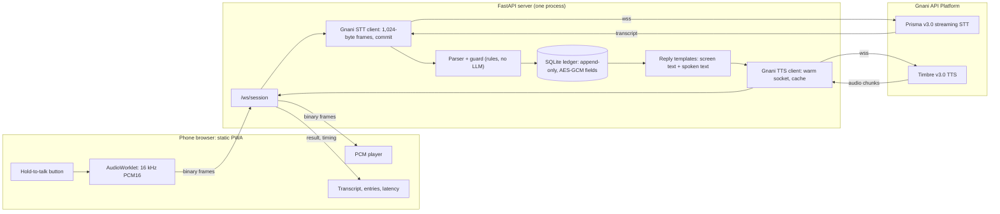

# Architecture (v1, 2026-11-21)

KhataVaani is a voice ledger for kirana udhaar. The shopkeeper holds one button, speaks a sentence such as
"Ramesh ka 340 udhaar, kal 200 diya tha", and hears a short confirmation. Interfaces are fixed in docs/CONTRACT.md.

## What the judges score, and where the design answers it

| Criterion (weight) | Design answer |
|---|---|
| Live judge test (30): task success, names and numbers, time to first audio | Rule-based number grammar and direction rules (`server/nlu`), spoken readback of every entry, `commit` on button release, warm TTS socket, per-turn timing |
| Speech-layer depth (20): streaming, barge-in, endpointing, code-mix, noise | Audio streams to Prisma v3.0 while the user speaks; pressing the button cuts the reply (barge-in); endpointing by button release plus Gnani's VAD segments; `transliterate` output and Hindi + English number words; `keyterms` biasing with customer names |
| Fit for the target user (20) | One large hold-to-talk button, no typing, static page that loads on a low-end Android browser, Hindi replies |
| Innovation (10) | Deterministic money path with an LLM nowhere near amounts; asks one short question only when in doubt; append-only ledger where a correction is a reversal |
| Responsible AI (10) | Disclosure in the first reply, encrypted names and transcripts, synthetic data, purge command, key only in `.env` |
| Demo and docs (10) | README, this diagram, demo script |

PS2 scoring: exact amount match, correct credit or payment direction, correction handling.

## Diagram

## One push-to-talk turn

1. Press: the browser sends `start` and stops any reply that is playing. The server makes sure its Gnani STT socket is open.
2. Hold: 16 kHz PCM frames flow browser → server → Gnani in real time, re-framed to 1,024 bytes. Gnani's `speech_start`
   and `processing` events drive the on-screen state.
3. Release: the browser sends `end`; the server sends `{"type":"commit"}` so Gnani closes the utterance without waiting
   for silence, then joins the transcript segments.
4. Parse: `nlu.parser.parse` returns events, a query, or one question. Nothing ambiguous is saved.
5. Save: one SQLite transaction. Only after the commit is the reply sent to Timbre v3.0 on the already-open socket.
6. Speak: audio chunks stream straight to the browser, which starts playing at the first chunk. A `timing` message
   reports each hop.

## Decisions and reasons

| Decision | Reason |
|---|---|
| STT `format=transliterate` by default | Gnani writes the whole transcript in Latin letters with numbers as words, so names need no script conversion and our own grammar decides the amount. The parser still accepts digits and Devanagari, so the format can change after the live test |
| Raw `websockets` clients, no SDK | The SDK cannot send `commit`, which is what makes finalisation immediate |
| One warm TTS socket per session | Gnani allows several requests per connection, so a reply never pays for a handshake |
| Spoken text in Devanagari with amounts as words | Gnani's guidance is to pass numbers as spoken words; four-digit numerals can be read digit by digit |
| No LLM anywhere | Amounts and direction must be exact and repeatable. Sentences the rules reject get a polite "say it again" |
| Field-level AES-256-GCM instead of SQLCipher | The SQLCipher wheel is blocked by Application Control on the dev machine. Names, tags, phones, transcripts and replies are encrypted; ids, amounts and dates stay plain so totals are SQL |
| Static web app with no bundler | No toolchain risk in 24 hours, the smallest download for a low-end phone, and the server serves it from the same origin |
| Gnani returns no confidence or alternatives | The guard relies on spoken readback and a plausibility limit |
| A bare "200 diya" after a named clause is a payment by that customer | This is exactly the example in the problem statement; the readback names the customer so a wrong reading is caught |
| Unknown names create a customer | Judges will use names the ledger has never seen. The readback says "Naya khata" |

## Manual steps (they need the real API key, a phone and a network)

1. Put `GNANI_API_KEY` in `.env`.
2. Run `scripts/live_smoke.py` once: it settles the transcript format, the `commit` behaviour and the real latency.
3. Test with real voices on a low-end Android phone in a noisy room.
4. Deploy or tunnel for HTTPS (the microphone needs a secure origin) and rehearse the demo.
5. After judging, run the purge command.
