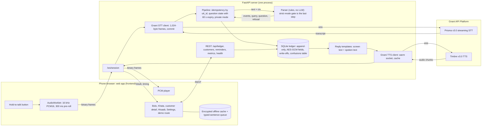

# Architecture (v2, 2026-11-21)

KhataVaani is a voice ledger for kirana udhaar. The shopkeeper holds one button, speaks a sentence such as
"Ramesh ka 340 udhaar, kal 200 diya tha", and hears a short confirmation. Interfaces are fixed in docs/CONTRACT.md
(version 1.4). The edge cases the rules were written against are in docs/EDGE_CASES.md.

## What the judges score, and where the design answers it

| Criterion (weight) | Design answer |
|---|---|
| Live judge test (30): task success, names and numbers, time to first audio | Rule-based number grammar and direction rules (`server/nlu`), spoken readback of every entry, questions instead of guesses, `commit` on button release, warm TTS socket, per-turn timing |
| Speech-layer depth (20): streaming, barge-in, endpointing, code-mix, noise | Audio streams to Prisma v3.0 while the user speaks; pressing the button cuts the reply (barge-in); endpointing by button release plus Gnani's VAD segments; 300 ms of audio kept from before the press and after the release; recordings under 0.5 s ignored; `transliterate` output and Hindi + English number words; `keyterms` biasing with customer names |
| Fit for the target user (20) | One large hold-to-talk button, Hindi replies, text size, contrast and speaking speed settings, private mode, a khata view that is cached for offline reading |
| Innovation (10) | Deterministic money path with an LLM nowhere near amounts; asks one short question only when in doubt; append-only ledger where a correction is a reversal; a table of this shop's corrected amounts that makes the app ask next time |
| Responsible AI (10) | Disclosure in the first reply, encrypted names and transcripts, synthetic data, purge command, key only in `.env`, opt-in reminders sent by the shopkeeper |
| Demo and docs (10) | README, this diagram, demo script |

PS2 scoring: exact amount match, correct credit or payment direction, correction handling.

## Diagram

## One push-to-talk turn

1. Press: the browser sends `start` (with a `utt_id`) and stops any reply that is playing. The server makes sure its
   Gnani STT socket is open. A press shorter than 0.5 s is discarded: nothing is parsed or spoken.
2. Hold: 16 kHz PCM frames flow browser → server → Gnani in real time, re-framed to 1,024 bytes. The browser has kept
   300 ms from before the press and sends 300 ms after the release. Gnani's `speech_start` and `processing` events
   drive the on-screen state.
3. Release: the browser sends `end`; the server sends `{"type":"commit"}` so Gnani closes the utterance without waiting
   for silence, then joins the transcript segments. Silence, an empty transcript, a turn cut at 30 s and a missing
   final transcript after 5 s each get their own reply and save nothing.
4. Parse: the pipeline builds the parser context (customers with balance and usual amount, the last turn and its age,
   limits, this shop's confusions) and calls `nlu.parser.parse`. The result is events, a query, a refusal, or one
   question. Nothing ambiguous is saved.
5. Save: one SQLite transaction holds the events and the utterance record. Only after the commit is the reply sent to
   Timbre v3.0 on the already-open socket.
6. Speak: audio chunks stream straight to the browser, which starts playing at the first chunk. A `timing` message
   reports each hop.

## Pieces added in contract 1.2 to 1.4

- **Strict-mode gate.** The parser's last step. When an append or amend would be saved and the sentence holds a word
  outside the parser's vocabulary, the result becomes a `confirm_entry` question of type `unsure`. Every other rule
  decides first, and queries, undo and answers to a pending question are not gated. Setting `STRICT_SAVE`.
- **New-customer question.** An unknown name is asked about before an account is opened (`CONFIRM_NEW_CUSTOMER`), with up
  to two close existing names as choices.
- **Question state with expiry.** An open question lives in the session and expires 60 seconds after it was asked. A
  reconnect with `resume` drops it unless the page sends `keep_pending`. Carry-over across turns needs an explicit
  continuation ("aur 200", "200 add kar do") within 60 seconds; any other amount with no name is asked "Kiska khata?".
- **Answers and corrections (1.3).** An answer with an undo word is a no, a denied name is never picked, two amounts in
  an answer are asked about again, and a correction is applied only right after the entry it corrects. A complete new
  sentence spoken while a question is open is parsed fresh and the question is dropped.
- **Questions that say what will be saved (1.4).** A question is built from the entry it is about. Each new name is
  asked about once. A sentence of several entries that needed a question about a missing or unclear field is read
  back in full before it is saved ("2 entry likhun: ..."). Dates, times and stated balances are never taken as
  amounts. A correction phrased as an instruction ("usko 430 kar do") and a reduction ("200 maaf kar do") are
  confirmed before they change the ledger.
- **Idempotency.** A turn's `utt_id` becomes the utterance id and is written in the same transaction as its events. A
  repeated `utt_id` writes nothing and returns the first result with `duplicate: true`.
- **Write-offs.** Stored as a payment with `adjustment='writeoff'`, so the balance arithmetic is unchanged; they are
  left out of payment totals and reported as kind `writeoff`.
- **Confusions table.** Each amend that changes only the amount adds a count for (heard, meant). Pairs seen twice
  or more go to the parser as `confusables`, which makes it ask next time ("₹340 ya ₹740?").
- **Private mode.** The page sends `private` in `hello` (or a `settings` message). Balance, top dues, outstanding total,
  since-when and summary answers are then shown, not spoken: the voice says "Jawab screen par hai."
- **Reminders.** Opt-in is per customer and logged. The message is rebuilt from the current balance when read, nothing is
  returned outside 09:00 to 20:00 shop time, and the page shows a prefilled WhatsApp link for the shopkeeper to send.
  There is no automatic sending and no message queue service.
- **Metrics.** `GET /api/metrics` returns counts of turns, saves, questions, rejections, corrections and undos, and the
  confusion pairs; it holds no names.
- **Static files.** The server serves `frontend/dist` when it has been built, `web/` otherwise, and `WEB_DIR` overrides.

## Web app (`frontend/`)

Vite, React, TypeScript and Tailwind, with hash routes, built to static files that the server serves from the same
origin. The session service wraps the WebSocket, the AudioWorklet capture (16 kHz PCM16 with a 300 ms pre-roll) and the
PCM player. Screens: Bolo (talk), Khata (customers), a customer detail page with the reminder opt-in, Hisaab
(insights) and Settings. A demo route plays a scripted session that never touches the real server. The khata view is
cached in encrypted form for offline reading, and sentences typed without a connection are queued and sent later with
their own turn ids, so a retry cannot save twice. Speech itself needs a connection. The earlier client in `web/`
(Preact + htm, no build step) is kept as a fallback.

## Decisions and reasons

| Decision | Reason |
|---|---|
| STT `format=transliterate` by default | Gnani writes the whole transcript in Latin letters with numbers as words, so names need no script conversion and our own grammar decides the amount. The parser still accepts digits and Devanagari, so the format can change |
| Raw `websockets` clients, no SDK | The SDK cannot send `commit`, which is what makes finalisation immediate |
| One warm TTS socket per session | Gnani allows several requests per connection, so a reply never pays for a handshake |
| Spoken text in Devanagari with amounts as words | Gnani's guidance is to pass numbers as spoken words; four-digit numerals can be read digit by digit |
| No LLM anywhere | Amounts and direction must be exact and repeatable. Sentences the rules reject get a polite refusal or one question |
| Strict mode as the last gate | A sentence with an unknown word is asked about instead of saved; the rules above it keep their own, more specific questions |
| Field-level AES-256-GCM instead of SQLCipher | The SQLCipher wheel is blocked by Application Control on the dev machine. Names, tags, phones, transcripts and replies are encrypted; ids, amounts and dates stay plain so totals are SQL |
| Build step for the main web app | The app has several screens, an offline cache and a typed queue; the output is plain static files. `web/` stays as a no-build fallback |
| Reminders through a prefilled WhatsApp link | The shopkeeper sends it, so nothing is sent without a person and only opted-in customers get one |
| Gnani returns no confidence or alternatives | The guard relies on spoken readback, `nahi`, and confirmations of unusual amounts |
| A bare "200 diya" after a named clause in the same sentence is a payment by that customer | This is exactly the example in the problem statement; the readback names the customer so a wrong reading is caught. As a new turn it is asked "Kiska khata?" |
| Unknown names are asked about | Judges will use names the ledger has never seen. With `CONFIRM_NEW_CUSTOMER=0` the account is opened and the readback says "Naya khata" |

## Manual steps (they need the real API key, a phone and a network)

1. Put `GNANI_API_KEY` in `.env`.
2. Run `scripts/live_smoke.py` once to check the transcript format, the `commit` behaviour and the real latency.
3. Test with real voices on a low-end Android phone in a noisy room, and run `scripts/replay_audio.py` with recordings.
4. Deploy or tunnel for HTTPS (the microphone needs a secure origin) and rehearse the demo.
5. After judging, run the purge command.
